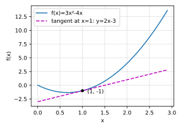
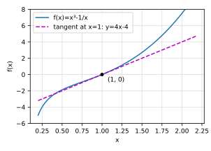

# d2l 2.4 微积分

> 教材：https://zh.d2l.ai/chapter_preliminaries/calculus.html
> 输出均为本机 `d2l` 环境实跑（torch 2.14.1 / numpy 1.26.4）。
> 前置：[2.3 线性代数](d2l-2.3-线性代数.md)　关联：[神经网络完整学习笔记](神经网络完整学习笔记.md) 第 8–9 节（手推损失函数导数与反向传播）

## 目录

1. 为什么深度学习要讲微积分
2. 导数的定义与数值实验（附一个书上没做的实验）
3. 常用求导法则
4. 切线的可视化
5. 偏导数
6. 梯度与四条向量求导法则
7. 链式法则
8. 练习 1–4
9. 小结

---

## 1. 为什么深度学习要讲微积分

"训练模型"就是**最小化损失函数** —— 一个衡量"模型有多糟"的分数。书里把拟合模型拆成两个问题：

| | 含义 |
|---|---|
| **优化** optimization | 用模型去拟合已观测到的数据 |
| **泛化** generalization | 让模型在**没见过**的数据上也好 —— 这才是真正关心的 |

本节服务于前者。核心那句话值得记住：

> 对每个参数，如果把它**增加或减少一个无穷小的量**，损失会以多快的速度变化 —— 这个"多快"就是导数。

有了它，就知道每个参数该往哪个方向挪。你那篇手推反向传播的笔记（第 8–9 节）做的就是这件事，这节是把它的数学工具正式化。

---

## 2. 导数的定义与数值实验

$$f'(x) = \lim_{h \rightarrow 0} \frac{f(x+h) - f(x)}{h}$$

解读：**$f(x)$ 相对于 $x$ 的瞬时变化率**，几何上是曲线在该点**切线的斜率**。$f'(a)$ 存在就说 $f$ 在 $a$ 处**可微**。

书上的实验：取 $f(x)=3x^2-4x$，在 $x=1$ 处让 $h$ 越来越小：

```python
def f(x): return 3 * x ** 2 - 4 * x
def numerical_lim(f, x, h): return (f(x + h) - f(x)) / h

h = 0.1
for i in range(5):
    print(f'h={h:.5f}, numerical limit={numerical_lim(f, 1, h):.5f}')
    h *= 0.1
```

```
h=0.10000, numerical limit=2.30000
h=0.01000, numerical limit=2.03000
h=0.00100, numerical limit=2.00300
h=0.00010, numerical limit=2.00030
h=0.00001, numerical limit=2.00003
```

越来越接近 **2**，和下一节手算的 $f'(1)=6\cdot1-4=2$ 吻合。

### 📌 书上没做的实验：继续把 h 变小会怎样

直觉上 h 越小越准。实际上**反过来**：

```
h=1e-5   近似=2.0000300000155846   误差=3.000e-05
h=1e-7   近似=2.000000298707505    误差=2.987e-07   ← 最准在这附近
h=1e-9   近似=2.000000165480742    误差=1.655e-07
h=1e-11  近似=2.000000165480742    误差=1.655e-07
h=1e-13  近似=1.9984014443252818   误差=1.599e-03   ← 开始变差
h=1e-15  近似=2.220446049250313    误差=2.204e-01
h=1e-17  近似=0.0                  误差=2.000e+00   ← 彻底崩掉
```

原因是两种误差在打架：

- **截断误差** $O(h)$：h 不够小，差商本身就不等于导数 → h 越小越好；
- **舍入误差** $O(\epsilon/h)$：分子 $f(x+h)-f(x)$ 是两个几乎相等的数相减（**灾难性抵消**），有效位数被吃光；h 越小越严重。

两者在 $h \approx \sqrt{\epsilon} \approx 10^{-8}$（float64）附近达到最优 —— 和上面实测的最准点一致。`h=1e-17` 时 $1+h$ 在 float64 里就等于 $1$，分子直接是 0。

**这就是深度学习不用数值微分的原因**：既不准又慢（每个参数都要多算一次 f，百万参数就要百万次）。框架用的是**自动微分**（下一节 2.5），按链式法则精确地算，一次反向传播拿到所有参数的导数。

---

## 3. 常用求导法则

等价记号（都是一回事）：

$$f'(x) = y' = \frac{dy}{dx} = \frac{df}{dx} = \frac{d}{dx}f(x) = Df(x)$$

**基本函数**

| 函数 | 导数 |
|---|---|
| $C$（常数） | $0$ |
| $x^n$ | $nx^{n-1}$（幂律，n 为任意实数） |
| $e^x$ | $e^x$ |
| $\ln x$ | $1/x$ |

**组合法则**

| 法则 | 公式 |
|---|---|
| 常数相乘 | $\frac{d}{dx}[Cf] = C\frac{d}{dx}f$ |
| 加法 | $\frac{d}{dx}[f+g] = \frac{d}{dx}f + \frac{d}{dx}g$ |
| 乘法 | $\frac{d}{dx}[fg] = f\frac{d}{dx}g + g\frac{d}{dx}f$ |
| 除法 | $\frac{d}{dx}\left[\frac{f}{g}\right] = \frac{g\frac{d}{dx}f - f\frac{d}{dx}g}{g^2}$ |

用它们算本节的例子：

$$u' = f'(x) = 3\frac{d}{dx}x^2 - 4\frac{d}{dx}x = 6x - 4 \quad\Rightarrow\quad f'(1) = 2 \;\checkmark$$

---

## 4. 切线的可视化

$f'(1)=2$ 就是曲线在 $x=1$ 处切线的斜率。切点 $(1, f(1)) = (1, -1)$，所以切线是 $y = 2x - 3$：

```python
x = np.arange(0, 3, 0.1)
d2l.plot(x, [f(x), 2 * x - 3], 'x', 'f(x)',
         legend=['f(x)', 'Tangent line (x=1)'])
```



> 书里这一段顺手定义了 `use_svg_display`、`set_figsize`、`set_axes`、`plot` 四个函数，并用 `#@save` 注释把它们存进 `d2l` 包 —— 所以后面章节直接 `d2l.plot(...)` 就能用，不必重新定义。`#@save` 是 d2l 书自己的机制，不是 Python 语法。

---

## 5. 偏导数

深度学习里的函数有很多变量，所以要推广到多元。对 $y = f(x_1, \ldots, x_n)$，关于第 $i$ 个变量的**偏导数**：

$$\frac{\partial y}{\partial x_i} = \lim_{h\to 0}\frac{f(x_1,\ldots,x_i+h,\ldots,x_n) - f(x_1,\ldots,x_i,\ldots,x_n)}{h}$$

**算法很简单：把其他变量全当常数，对 $x_i$ 求普通导数。**

等价记号：$\frac{\partial y}{\partial x_i} = \frac{\partial f}{\partial x_i} = f_{x_i} = f_i = D_i f$。

---

## 6. 梯度与四条向量求导法则

把对所有变量的偏导数拼成一个向量，就是**梯度**。对 $f: \mathbb{R}^n \to \mathbb{R}$（输入向量、输出标量）：

$$\nabla_{\mathbf{x}} f(\mathbf{x}) = \left[\frac{\partial f}{\partial x_1}, \frac{\partial f}{\partial x_2}, \ldots, \frac{\partial f}{\partial x_n}\right]^\top$$

**梯度和输入 $\mathbf{x}$ 同形状** —— 这点很实用：后面 `param.grad` 的形状永远和 `param` 一样。几何上梯度指向函数**增长最快**的方向，所以梯度下降要往 $-\nabla f$ 走。

### 四条法则（书上给的）

设 $\mathbf{x} \in \mathbb{R}^n$：

| 法则 | 公式 |
|---|---|
| $\mathbf{A} \in \mathbb{R}^{m\times n}$ | $\nabla_{\mathbf{x}}\mathbf{A}\mathbf{x} = \mathbf{A}^\top$ |
| $\mathbf{A} \in \mathbb{R}^{n\times m}$ | $\nabla_{\mathbf{x}}\mathbf{x}^\top\mathbf{A} = \mathbf{A}$ |
| $\mathbf{A} \in \mathbb{R}^{n\times n}$ | $\nabla_{\mathbf{x}}\mathbf{x}^\top\mathbf{A}\mathbf{x} = (\mathbf{A}+\mathbf{A}^\top)\mathbf{x}$ |
| | $\nabla_{\mathbf{x}}\\|\mathbf{x}\\|^2 = \nabla_{\mathbf{x}}\mathbf{x}^\top\mathbf{x} = 2\mathbf{x}$ |

矩阵版：$\nabla_{\mathbf{X}}\\|\mathbf{X}\\|_F^2 = 2\mathbf{X}$。

注意第三条用到了 [2.3 练习 3](d2l-2.3-线性代数.md) 的结论 —— $\mathbf{A}+\mathbf{A}^\top$ 是对称的；当 $\mathbf{A}$ 本身对称时它简化成 $2\mathbf{A}\mathbf{x}$。

### 用 autograd 核对（下一节的工具，这里先借来验算）

```python
M = torch.randn(4, 4); x = torch.randn(4, requires_grad=True)
(x @ M @ x).backward()
torch.allclose(x.grad, (M + M.T) @ x.detach(), atol=1e-5)   # True ✓

x = torch.randn(4, requires_grad=True)
(x @ x).backward()
torch.allclose(x.grad, 2 * x.detach())                      # True ✓
```

$\nabla_{\mathbf{x}}(\mathbf{1}^\top\mathbf{A}\mathbf{x}) = \mathbf{A}^\top\mathbf{1}$（即 A 的各列之和）也验过，为 `True`。**这几条规则不用背** —— 知道它们存在、会用 autograd 验证就够了。

---

## 7. 链式法则

实际的损失函数是层层**复合**的（loss ← 输出 ← 隐层 ← 权重），单条规则套不上，靠链式法则。

**单变量**：$y=f(u)$、$u=g(x)$，则

$$\frac{dy}{dx} = \frac{dy}{du}\cdot\frac{du}{dx}$$

**多变量**：$y$ 依赖 $u_1,\ldots,u_m$，每个 $u_j$ 又依赖 $x_1,\ldots,x_n$，则

$$\frac{\partial y}{\partial x_i} = \sum_{j=1}^{m}\frac{\partial y}{\partial u_j}\frac{\partial u_j}{\partial x_i} = \frac{\partial y}{\partial u_1}\frac{\partial u_1}{\partial x_i} + \cdots + \frac{\partial y}{\partial u_m}\frac{\partial u_m}{\partial x_i}$$

**读法**：$x_i$ 的变化会通过**每一条路径**（经由各个 $u_j$）影响 $y$，把所有路径的贡献**相加**。

这正是反向传播的全部数学内容 —— 一个神经元的输出流向下一层的多个神经元，它的"责任"就是这些路径回传的梯度之和。见[神经网络完整学习笔记](神经网络完整学习笔记.md) 第 9.3 节手算的两层例子。

---

## 8. 练习 1–4

### 练习 1：绘制 $y = x^3 - \frac{1}{x}$ 及其在 $x=1$ 处的切线

求导：$f'(x) = 3x^2 + \dfrac{1}{x^2}$（注意 $-\frac{1}{x} = -x^{-1}$，导数为 $+x^{-2}$，**两项同号**）。

在 $x=1$：$f(1) = 1 - 1 = 0$，$f'(1) = 3 + 1 = 4$。切线过 $(1,0)$、斜率 4：

$$y = 4(x-1) = 4x - 4$$

```python
x = np.arange(0.2, 2.2, 0.02)      # 避开 x=0（那里有极点）
d2l.plot(x, [x**3 - 1/x, 4*x - 4], 'x', 'f(x)',
         legend=['f(x)=x³-1/x', 'Tangent line (x=1)'])
```



autograd 验证：`f(1)=0.0, f'(1)=4.0` ✓

### 练习 2：求 $f(\mathbf{x}) = 3x_1^2 + 5e^{x_2}$ 的梯度

逐个偏导（另一个变量当常数）：

$$\frac{\partial f}{\partial x_1} = 6x_1, \qquad \frac{\partial f}{\partial x_2} = 5e^{x_2}$$

$$\nabla f(\mathbf{x}) = \begin{bmatrix}6x_1 \\ 5e^{x_2}\end{bmatrix}$$

在 $\mathbf{x} = [1.5, 0.7]^\top$ 处实测：

```
autograd: [9.0, 10.068764]      手算 [6×1.5, 5e^0.7] = [9.0, 10.068764]   ✓
```

### 练习 3：$f(\mathbf{x}) = \\|\mathbf{x}\\|_2$ 的梯度是什么？

$f(\mathbf{x}) = \sqrt{\sum_i x_i^2}$，对 $x_i$ 求偏导：

$$\frac{\partial f}{\partial x_i} = \frac{1}{2}\left(\sum_j x_j^2\right)^{-1/2}\cdot 2x_i = \frac{x_i}{\\|\mathbf{x}\\|_2}$$

$$\boxed{\nabla_{\mathbf{x}}\\|\mathbf{x}\\|_2 = \frac{\mathbf{x}}{\\|\mathbf{x}\\|_2}} \quad (\mathbf{x} \neq \mathbf{0})$$

**这是 x 方向上的单位向量** —— 长度恒为 1，只带方向信息。对比 $\nabla\\|\mathbf{x}\\|^2 = 2\mathbf{x}$（长度随 x 增长）：这就是为什么深度学习里偏爱用 **L2 范数的平方**而不是 L2 范数本身 —— 平方的梯度更简洁，也没有下面这个麻烦。

实测 $\mathbf{x} = [3, -4]^\top$（$\\|\mathbf{x}\\|=5$）：

```
autograd: [0.6, -0.8]     手算 x/||x|| = [0.6, -0.8]   ✓
```

> ⚠️ **$\mathbf{x} = \mathbf{0}$ 处不可微**（分母为 0，几何上是个尖点，就像 $|x|$ 在原点）。但 PyTorch 在那里**不报错，返回梯度 0**：
>
> ```python
> x = torch.zeros(2, requires_grad=True)
> torch.linalg.vector_norm(x).backward()
> x.grad      # tensor([0., 0.])   ← 数学上无定义，框架给了个次梯度
> ```
>
> 这类"框架替你选了一个值"的情况要知道，否则调试时会困惑。ReLU 在 0 处也是同样的事。

### 练习 4：写出 $u = f(x,y,z)$，其中 $x=x(a,b)$、$y=y(a,b)$、$z=z(a,b)$ 的链式法则

$u$ 对 $a$ 的依赖有三条路径（经 x、经 y、经 z），全部相加：

$$\frac{\partial u}{\partial a} = \frac{\partial u}{\partial x}\frac{\partial x}{\partial a} + \frac{\partial u}{\partial y}\frac{\partial y}{\partial a} + \frac{\partial u}{\partial z}\frac{\partial z}{\partial a}$$

$$\frac{\partial u}{\partial b} = \frac{\partial u}{\partial x}\frac{\partial x}{\partial b} + \frac{\partial u}{\partial y}\frac{\partial y}{\partial b} + \frac{\partial u}{\partial z}\frac{\partial z}{\partial b}$$

即第 7 节通式中 $m=3$（中间变量 x,y,z）、$n=2$（自变量 a,b）的情形。

写成矩阵形式更紧凑（这就是**雅可比矩阵**，也是 autograd 的实际工作方式）：

$$\begin{bmatrix}\dfrac{\partial u}{\partial a} \\[2mm] \dfrac{\partial u}{\partial b}\end{bmatrix} = \underbrace{\begin{bmatrix}\dfrac{\partial x}{\partial a} & \dfrac{\partial y}{\partial a} & \dfrac{\partial z}{\partial a} \\[2mm] \dfrac{\partial x}{\partial b} & \dfrac{\partial y}{\partial b} & \dfrac{\partial z}{\partial b}\end{bmatrix}}_{J^\top} \begin{bmatrix}\dfrac{\partial u}{\partial x} \\[2mm] \dfrac{\partial u}{\partial y} \\[2mm] \dfrac{\partial u}{\partial z}\end{bmatrix}$$

---

## 9. 小结

| 概念 | 一句话 |
|---|---|
| 导数 | 瞬时变化率 = 切线斜率；$f'(x)=\lim_{h\to0}\frac{f(x+h)-f(x)}{h}$ |
| 偏导数 | 其他变量当常数，对一个变量求导 |
| 梯度 | 所有偏导数拼成的向量，**与输入同形状**，指向增长最快的方向 |
| 链式法则 | 复合函数求导：**所有路径的贡献相加** —— 反向传播的全部数学 |

**本节要记住的三件事**

1. 训练 = 最小化损失，而导数告诉我们每个参数该往哪挪；
2. **数值微分不可用**：h 太小会因灾难性抵消而崩（实测 `1e-17` 直接得 0），最优 h 只在 $\sqrt{\epsilon}\approx10^{-8}$ 附近 —— 所以框架用自动微分；
3. $\nabla\\|\mathbf{x}\\|^2 = 2\mathbf{x}$ 简洁，而 $\nabla\\|\mathbf{x}\\|_2 = \mathbf{x}/\\|\mathbf{x}\\|_2$ 在原点不可微 —— 这是深度学习偏爱平方范数的原因。
