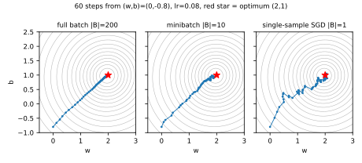
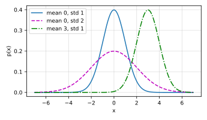
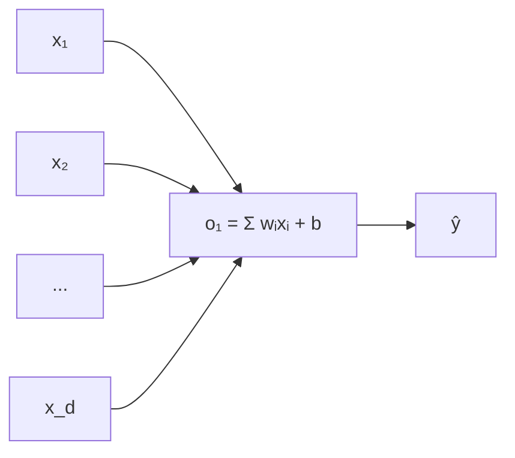
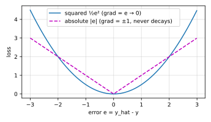

# d2l 3.1 线性回归

> 教材：https://zh.d2l.ai/chapter_linear-networks/linear-regression.html
> 输出均为本机 `d2l` 环境实跑（torch 2.14.1）。
> 前置：[2.3 线性代数](d2l-2.3-线性代数.md)、[2.4 微积分](d2l-2.4-微积分.md)
> 实现篇：[3.2 从零开始实现](d2l-3.2-线性回归的从零开始实现.md)、[3.3 简洁实现](d2l-3.3-线性回归的简洁实现.md)

## 目录

1. 为什么从线性回归开始
2. 术语对照表
3. 线性模型
4. 损失函数：平方误差
5. 解析解（正规方程）
6. 小批量随机梯度下降
   - 6.5 **详解：手算一步** ★
7. 矢量化加速（实测 1.8 万倍）
8. 正态分布与平方损失：为什么是平方 ★
9. 线性回归就是单层神经网络
10. 练习 1–3
11. 小结

★ = 本节最值得理解的一段。

---

## 1. 为什么从线性回归开始

**回归**是给"一个或多个自变量"与"因变量"之间的关系建模。预测数值 → 回归；预测属于哪一类 → 分类（3.4 起）。

线性回归值得认真学，不是因为它强，而是因为**机器学习模型的四个关键要素它全都有，而且只有它能用公式写出精确答案**：

| 要素 | 线性回归里是什么 |
|---|---|
| 模型 | $\hat{y} = \mathbf{w}^\top\mathbf{x} + b$ |
| 损失函数 | 平方误差 |
| 优化算法 | 小批量 SGD |
| 训练数据 | 特征矩阵 $\mathbf{X}$ 与标签 $\mathbf{y}$ |

后面所有模型都是换掉"模型"这一格，另外三格的套路一模一样。

**线性回归的两个假设**：① $y$ 是 $\mathbf{x}$ 各分量的加权和；② 噪声服从正态分布（第 8 节会看到这个假设直接决定了损失函数的形状）。

---

## 2. 术语对照表

| 中文 | 英文 | 含义 |
|---|---|---|
| 训练集 | training set | 用来拟合的数据 |
| 样本 / 数据点 | sample / data point / instance | 一行数据 |
| 标签 / 目标 | label / target | 要预测的那个值（房价） |
| 特征 / 协变量 | feature / covariate | 预测所依据的量（面积、房龄） |
| 权重 | weight | 每个特征的影响大小 |
| 偏置 / 截距 | bias / offset / intercept | 所有特征为 0 时的预测值 |
| 超参数 | hyperparameter | 不在训练中更新的参数（学习率、批量大小） |
| 泛化 | generalization | 在没见过的数据上也表现好 |

记号：$n$ 个样本，第 $i$ 个样本的特征是 $\mathbf{x}^{(i)}$、标签是 $y^{(i)}$；上标带括号表示**样本编号**，下标表示**特征编号**。

---

## 3. 线性模型

房价例子：

$$\mathrm{price} = w_{\mathrm{area}}\cdot\mathrm{area} + w_{\mathrm{age}}\cdot\mathrm{age} + b$$

推广到 $d$ 个特征，单个样本：

$$\hat{y} = w_1x_1 + \cdots + w_dx_d + b = \mathbf{w}^\top\mathbf{x} + b$$

**整个数据集一次算完**（$\mathbf{X} \in \mathbb{R}^{n\times d}$，每行一个样本）：

$$\hat{\mathbf{y}} = \mathbf{X}\mathbf{w} + b, \qquad \hat{\mathbf{y}} \in \mathbb{R}^n$$

这里 $\mathbf{X}\mathbf{w}$ 是 $(n,d)\times(d,) \to (n,)$ 的矩阵-向量积（[2.3](d2l-2.3-线性代数.md) 第 7 节），而 $+b$ 是标量**广播**到 $n$ 个分量上（[2.1](d2l-2.1-数据操作.md) 第 6 节）。前两节的工具在这里第一次合起来用。

**关于偏置 b**：它是"所有特征为 0 时的预测值"。现实中没有面积为 0 的房子，但没有 $b$ 的话模型被迫过原点，表达能力会受限。严格说这是**仿射变换**（线性变换 + 平移），不是纯线性变换。

**关于噪声**：即使相信真实关系是线性的，也几乎不可能有数据集让所有 $y^{(i)}$ 精确等于 $\mathbf{w}^\top\mathbf{x}^{(i)}+b$ —— 观测总有误差。所以模型写成

$$y = \mathbf{w}^\top\mathbf{x} + b + \epsilon$$

---

## 4. 损失函数：平方误差

单个样本：

$$l^{(i)}(\mathbf{w},b) = \frac{1}{2}\left(\hat{y}^{(i)} - y^{(i)}\right)^2$$

整个数据集（取均值）：

$$L(\mathbf{w},b) = \frac{1}{n}\sum_{i=1}^{n}l^{(i)} = \frac{1}{n}\sum_{i=1}^{n}\frac{1}{2}\left(\mathbf{w}^\top\mathbf{x}^{(i)} + b - y^{(i)}\right)^2$$

目标：

$$\mathbf{w}^*, b^* = \operatorname*{argmin}_{\mathbf{w},b} L(\mathbf{w},b)$$

两个细节：

- **那个 $\frac{1}{2}$ 纯粹是为了好看** —— 求导时平方的 2 和它相消，梯度里不留系数。不影响最优解位置。
- **平方项让大误差被放大**：误差 10 的样本贡献是误差 1 的 100 倍。所以平方损失对离群点敏感（练习 3 会看到换成绝对值损失是什么后果）。

---

## 5. 解析解（正规方程）

线性回归特殊在：**它的最优解有闭式公式**。把偏置吸收进 $\mathbf{w}$（给 $\mathbf{X}$ 添一列全 1），问题变成最小化 $\\|\mathbf{y} - \mathbf{X}\mathbf{w}\\|^2$，令导数为 0 得：

$$\boxed{\mathbf{w}^* = (\mathbf{X}^\top\mathbf{X})^{-1}\mathbf{X}^\top\mathbf{y}}$$

（推导见练习 2。）实测 500 样本 3 特征 + 偏置、噪声 σ=0.01：

```
正规方程解 = [2.0, -3.4, 1.5002, 4.1999]
lstsq 解   = [2.0, -3.4, 1.5002, 4.1999]
真值       = [2.0, -3.4, 1.5,    4.2  ]
```

**但深度学习几乎不用它**，原因在练习 2d：要求 $\mathbf{X}^\top\mathbf{X}$ 可逆（特征不能共线）、要对 $d\times d$ 矩阵求逆（$d$ 大时不可行），而且只适用于这种能写出闭式解的模型。书里那句话说得准：

> 解析解可以进行很好的数学分析，但对问题的限制很严格，导致它无法广泛应用在深度学习里。

---

## 6. 小批量随机梯度下降

**梯度下降**：沿损失下降最快的方向（负梯度）反复挪动参数。

直接用全部数据算一次梯度叫批量梯度下降，很慢 —— 每更新一次参数都要遍历整个数据集。实际用**小批量随机梯度下降**：每次随机抽一小批 $\mathcal{B}$，用它的平均损失算梯度：

$$(\mathbf{w},b) \leftarrow (\mathbf{w},b) - \frac{\eta}{|\mathcal{B}|}\sum_{i\in\mathcal{B}}\partial_{(\mathbf{w},b)}\,l^{(i)}(\mathbf{w},b)$$

对平方损失 + 仿射变换，梯度可以明确写出来（3.2 从零实现时就是照这个写的）：

$$\begin{aligned}
\mathbf{w} &\leftarrow \mathbf{w} - \frac{\eta}{|\mathcal{B}|}\sum_{i\in\mathcal{B}}\mathbf{x}^{(i)}\left(\mathbf{w}^\top\mathbf{x}^{(i)} + b - y^{(i)}\right)\\
b &\leftarrow b - \frac{\eta}{|\mathcal{B}|}\sum_{i\in\mathcal{B}}\left(\mathbf{w}^\top\mathbf{x}^{(i)} + b - y^{(i)}\right)
\end{aligned}$$

注意括号里就是**残差** $\hat{y}-y$：梯度 = 残差 × 对应特征。残差为 0 时梯度为 0，这正是平方损失的好性质（对比第 10 节练习 3）。

**算法**：① 随机初始化参数；② 重复：抽小批量 → 算梯度 → 沿负梯度挪一步。

**两个超参数**（不由训练得到，要手动设，靠在**验证集**上看结果来调）：

| 超参数 | 符号 | 作用 |
|---|---|---|
| 学习率 | $\eta$ | 每步挪多远。太大会震荡/发散，太小收敛慢 |
| 批量大小 | $\|\mathcal{B}\|$ | 每次用多少样本估计梯度 |

书里两句重要的提醒：

1. **即使数据无噪声且真是线性的，SGD 也不会精确到达最小值** —— 它只是缓慢收敛，有限步内到不了。
2. 线性回归的损失平面只有一个最小值，但深度网络有很多个。而且实践者**并不执着于把训练损失压到最小** —— 真正难的是泛化。

---

---

## 6.5 小批量 SGD 详解：手算一步

第 6 节的公式一眼看过去符号很多，其实一步更新只有四件事。用一个三样本的玩具数据走一遍（真实关系 $y = 2x+1$，单特征，所以参数只有 $w, b$ 两个）：

| 样本 | $x$ | $y$ |
|---|---|---|
| 1 | 1 | 3 |
| 2 | 2 | 5 |
| 3 | 3 | 7 |

初始 $w=0$、$b=0$，学习率 $\eta = 0.1$。

### 第 1 步：抽到小批量 $\mathcal{B} = \{样本1, 样本2\}$，$|\mathcal{B}|=2$

**① 前向：算这批的预测和残差**

$$\hat{y}^{(1)} = 0\cdot1 + 0 = 0,\quad \hat{y}^{(2)} = 0\cdot2+0 = 0$$

$$\text{残差}\;\hat{y}-y:\quad 0-3 = -3,\qquad 0-5 = -5$$

**② 算梯度：梯度 = 残差 × 特征，再对这批取平均**

$$\frac{\partial L}{\partial w} = \frac{1}{|\mathcal{B}|}\sum_{i\in\mathcal{B}} x^{(i)}(\hat{y}^{(i)}-y^{(i)}) = \frac{1\cdot(-3) + 2\cdot(-5)}{2} = \frac{-13}{2} = -6.5$$

$$\frac{\partial L}{\partial b} = \frac{1}{|\mathcal{B}|}\sum_{i\in\mathcal{B}}(\hat{y}^{(i)}-y^{(i)}) = \frac{-3 + (-5)}{2} = -4.0$$

**③ 更新：沿负梯度挪一步**

$$w \leftarrow 0 - 0.1\times(-6.5) = 0.65, \qquad b \leftarrow 0 - 0.1\times(-4.0) = 0.40$$

梯度是负的 → 减去负数 = 加上去 → 参数变大。合理：当前预测（0）比真值（3、5）小，就该把 $w,b$ 调大。

**④ 梯度清零**，进入下一批。

autograd 核对（`l.sum().backward()` 得到的是未除以 $|\mathcal{B}|$ 的和）：

```
autograd: w.grad = -13.0   b.grad = -8.0
除以 |B|=2 → -6.5, -4.0     与手算一致 ✓
```

### 第 2 步：抽到 $\mathcal{B} = \{样本3\}$，$|\mathcal{B}|=1$

$$\hat{y}^{(3)} = 0.65\times3 + 0.40 = 2.35,\qquad \text{残差} = 2.35 - 7 = -4.65$$

$$\partial_w = 3\times(-4.65) = -13.95,\qquad \partial_b = -4.65$$

$$w \leftarrow 0.65 + 0.1\times13.95 = 2.045,\qquad b \leftarrow 0.40 + 0.1\times4.65 = 0.865$$

两步之后 $(w,b) = (2.045, 0.865)$，已经很接近真值 $(2, 1)$ 了。实测 autograd 给出同样的数（`w.grad = -13.95, b.grad = -4.65`）。

### 为什么"随机"抽一小批就够了

关键问题：只用 2 个样本算出的梯度，凭什么能代表全部数据？

答案是**它是全量梯度的无偏估计** —— 方向大致对，只是带噪声。同一个玩具数据在 $(w,b)=(0,0)$ 处实测：

```
全部 3 个样本的平均梯度:  (-11.33, -5.00)   ← "正确"方向
  只用样本 1:            ( -3.00, -3.00)
  只用样本 2:            (-10.00, -5.00)
  只用样本 3:            (-21.00, -7.00)
  用样本 {1,2}:          ( -6.50, -4.00)
  用样本 {2,3}:          (-15.50, -6.00)
```

单样本的估计偏得很厉害（-3 到 -21），但**都是朝着同一侧**（都是负的，都说"参数该变大"）。批量变大，估计就向全量梯度收敛 —— 噪声按 $1/\sqrt{|\mathcal{B}|}$ 缩小。

### 三种批量大小的路径对比

把批量大小取到两个极端来看：$|\mathcal{B}|=n$（全量）、$|\mathcal{B}|=10$（小批量）、$|\mathcal{B}|=1$（单样本）。下图是 200 个样本的单特征线性回归，在 $(w,b)$ 平面上画损失等高线和 60 步的实际轨迹（红星是最优点）：



实测数据：

| 批量 | 60 步后距最优点 | 末 10 步抖动 | 这 60 步总共算了多少样本 |
|---|---|---|---|
| $\|\mathcal{B}\|=200$（全量） | 0.0597 | 0.0143 | 12000 |
| $\|\mathcal{B}\|=10$ | 0.1491 | 0.0254 | 600 |
| $\|\mathcal{B}\|=1$ | 0.1718 | 0.0771 | 60 |

读法：

- **全量**路径最光滑、最终最准，但每一步都要遍历全部数据 —— 这 60 步的代价是小批量的 **20 倍**；
- **单样本**路径抖得最厉害（抖动 0.077，是全量的 5 倍），在最优点附近来回弹，而且**没法并行**（一个样本喂不满 GPU）；
- **小批量**在两者之间：代价只有全量的 1/20，精度却接近它。

这就是小批量的全部理由：**用很小的计算代价换到一个足够好的梯度方向**。所谓"随机"（stochastic）指的就是梯度带噪声这件事。

> 补充一点书里没讲但实践中重要的：那个噪声**不全是坏事**。深度网络的损失平面有很多局部极小和鞍点，噪声能帮参数跳出去；全量梯度下降反而容易卡死在鞍点上。

### 和 3.2 代码的对应关系

手算的四步，在[从零实现](d2l-3.2-线性回归的从零开始实现.md)里逐行对应：

```python
for X, y in data_iter(batch_size, features, labels):   # 抽小批量 B
    l = loss(net(X, w, b), y)      # ① 前向:算这批每个样本的损失
    l.sum().backward()             # ② 反向:得到"和"形式的梯度
    sgd([w, b], lr, batch_size)    # ③ 更新(内部除以 |B| 再挪一步) ④ 清零
```

`sgd` 内部就是上面第 ③④ 步：

```python
param -= lr * param.grad / batch_size   # ③ 除以 |B| 把"和"变"平均",沿负梯度挪
param.grad.zero_()                      # ④ 清零
```

**为什么要除以 `batch_size`**：`l.sum()` 把这批的损失加起来，梯度也是"和"。不除的话，批量越大梯度越大、步子越长 —— 换个批量大小就得重调学习率。除掉之后学习率的含义与批量大小**解耦**。（[3.3 练习 1](d2l-3.3-线性回归的简洁实现.md) 用实验验证了这件事。）

### 三个术语别搞混

| 术语 | 含义 | 本节例子 |
|---|---|---|
| **一步**（iteration / step） | 处理一个小批量 + 更新一次参数 | 上面手算的"第 1 步" |
| **一轮**（epoch） | 把训练集完整遍历一遍 | 1000 样本 / 批量 10 = 100 步 = 1 轮 |
| **批量大小**（batch size） | 一个小批量里有多少样本 | $\|\mathcal{B}\|$ = 2 |

所以 3.2 里"3 轮、批量 10、1000 样本"意味着参数一共被更新了 $3\times100 = 300$ 次，而不是 3 次。

## 7. 矢量化加速（实测 1.8 万倍）

两个 10000 维向量相加，`for` 循环 vs 直接 `a + b`：

```python
n = 10000
a, b = torch.ones(n), torch.ones(n)

c = torch.zeros(n)
for i in range(n):          # 逐元素
    c[i] = a[i] + b[i]

d = a + b                   # 矢量化
```

实测（矢量化那边重复 10000 次取平均，否则单次太快测不准）：

```
for 循环 (n=10000)       : 21.50 ms
矢量化 a+b               : 1.20 µs
加速比                   : 17968×
```

快四个数量级。原因：矢量化调用的是编译好的 BLAS 库，一次处理整块内存（还能用 SIMD、多线程），而 Python 的 for 循环每次迭代都有解释器开销、每个元素都要包装成 0 维张量。

**结论：训练代码里不要写逐元素的 Python 循环。** 书里还提了一句同样重要的理由 —— 把数学交给库，自己写的代码少，出错机会也少。

> 书里顺手定义了一个 `Timer` 类（`#@save` 存进 d2l 包），后面章节用 `d2l.Timer()` 计时。

---

## 8. 正态分布与平方损失：为什么是平方 ★

这一段回答了一个本该问的问题：**损失函数为什么偏偏选平方,而不是绝对值或四次方？**

正态分布的密度：

$$p(x) = \frac{1}{\sqrt{2\pi\sigma^2}}\exp\left(-\frac{1}{2\sigma^2}(x-\mu)^2\right)$$



改变均值 $\mu$ → 曲线沿 x 轴平移；增大方差 $\sigma^2$ → 变矮变胖。

### 推导：高斯噪声下，最小化平方误差 = 极大似然估计

假设 $y = \mathbf{w}^\top\mathbf{x} + b + \epsilon$，其中 $\epsilon \sim \mathcal{N}(0,\sigma^2)$。那么给定 $\mathbf{x}$ 观测到某个 $y$ 的**似然**是：

$$P(y\mid\mathbf{x}) = \frac{1}{\sqrt{2\pi\sigma^2}}\exp\left(-\frac{1}{2\sigma^2}\left(y - \mathbf{w}^\top\mathbf{x} - b\right)^2\right)$$

整个数据集（样本独立，所以**相乘**）：

$$P(\mathbf{y}\mid\mathbf{X}) = \prod_{i=1}^{n}p(y^{(i)}\mid\mathbf{x}^{(i)})$$

极大似然估计 = 选参数让这个乘积最大。一堆指数相乘不好处理，取对数变成相加；又因为习惯上说"最小化"，所以改为最小化**负对数似然**：

$$-\log P(\mathbf{y}\mid\mathbf{X}) = \sum_{i=1}^{n}\underbrace{\frac{1}{2}\log(2\pi\sigma^2)}_{\text{与 } \mathbf{w},b \text{ 无关}} + \frac{1}{2\sigma^2}\underbrace{\left(y^{(i)} - \mathbf{w}^\top\mathbf{x}^{(i)} - b\right)^2}_{\text{就是平方误差}}$$

把 $\sigma$ 当固定常数：第一项是常数可丢，第二项除了系数 $\frac{1}{\sigma^2}$ 就是平方误差之和，而解不依赖 $\sigma$。于是：

> **在高斯噪声假设下，最小化均方误差 ⟺ 对线性模型做极大似然估计。**

这是本节最重要的一句。它说明平方损失不是随便选的 —— **选损失函数等于选噪声模型**。练习 3 把噪声换成指数（拉普拉斯）分布，损失就变成绝对值误差，整个优化的性质跟着变。

---

## 9. 线性回归就是单层神经网络

把线性回归画成神经网络的样子：



术语：

- 输入层有 $d$ 个输入（**特征维度** feature dimensionality），输出层 1 个输出；
- **算层数时不数输入层**（输入只是给定的值，不做计算），所以这是**单层**神经网络；
- 每个输入都连到每个输出，这种层叫**全连接层**（fully-connected layer）或**稠密层**（dense layer）。在 3.3 里它就是 `nn.Linear(d, 1)`。

关于生物学类比，书里的态度值得记一句：**虽然飞机受鸟类启发，但鸟类学从来不是航空创新的主要驱动力** —— 现在深度学习的灵感主要来自数学、统计和计算机科学，而不是神经科学。

---

## 10. 练习 1–3

### 练习 1：求使 $\sum_i(x_i-b)^2$ 最小的常数 $b$

**(a) 解析解。** 对 $b$ 求导并置零：

$$\frac{d}{db}\sum_{i=1}^{n}(x_i-b)^2 = -2\sum_{i=1}^{n}(x_i - b) = 0 \;\Longrightarrow\; \sum_i x_i = nb \;\Longrightarrow\; \boxed{b^* = \frac{1}{n}\sum_i x_i = \bar{x}}$$

二阶导数 $2n > 0$，确实是极小值。**最优常数就是样本均值。**

实测（1000 个样本，均值 7.006）：SGD 迭代 2000 步得到 `7.006355`，与 `x.mean() = 7.006367` 一致 ✓

**(b) 与正态分布的关系。** 由第 8 节：平方误差之和等价于高斯似然的负对数。所以"用均值作为估计"就是**在高斯噪声假设下对分布均值 $\mu$ 做极大似然估计** —— 这也是本练习是上一节推导的最小特例：特征矩阵退化成一列全 1，模型只剩偏置 $b$，解自然就是 $\bar{x}$。

（顺带：如果改用绝对值损失 $\sum_i|x_i-b|$，最优解会变成**中位数**而不是均值 —— 对应拉普拉斯噪声，见练习 3。）

### 练习 2：推导线性回归的解析解

**(a) 矩阵形式。** 忽略偏置（给 $\mathbf{X}$ 加一列全 1 来吸收它）：

$$\min_{\mathbf{w}}\; L(\mathbf{w}) = \frac{1}{2}\\|\mathbf{y} - \mathbf{X}\mathbf{w}\\|^2, \qquad \mathbf{X}\in\mathbb{R}^{n\times d},\;\mathbf{y}\in\mathbb{R}^n$$

**(b) 梯度。** 展开：

$$L = \frac{1}{2}(\mathbf{y}-\mathbf{X}\mathbf{w})^\top(\mathbf{y}-\mathbf{X}\mathbf{w}) = \frac{1}{2}\left(\mathbf{y}^\top\mathbf{y} - 2\mathbf{w}^\top\mathbf{X}^\top\mathbf{y} + \mathbf{w}^\top\mathbf{X}^\top\mathbf{X}\mathbf{w}\right)$$

用 [2.4](d2l-2.4-微积分.md) 第 6 节的两条法则（$\nabla_\mathbf{w}\mathbf{w}^\top\mathbf{a} = \mathbf{a}$，$\nabla_\mathbf{w}\mathbf{w}^\top\mathbf{A}\mathbf{w} = (\mathbf{A}+\mathbf{A}^\top)\mathbf{w} = 2\mathbf{A}\mathbf{w}$ 当 $\mathbf{A}$ 对称）：

$$\nabla_{\mathbf{w}}L = -\mathbf{X}^\top\mathbf{y} + \mathbf{X}^\top\mathbf{X}\mathbf{w} = \mathbf{X}^\top(\mathbf{X}\mathbf{w}-\mathbf{y})$$

（$\mathbf{X}^\top\mathbf{X}$ 是对称的，因为 $(\mathbf{X}^\top\mathbf{X})^\top = \mathbf{X}^\top\mathbf{X}$。形式上也很好记：**梯度 = 设计矩阵的转置 × 残差**。）

**(c) 置零求解。**

$$\mathbf{X}^\top\mathbf{X}\mathbf{w} = \mathbf{X}^\top\mathbf{y} \quad(\text{正规方程}) \;\Longrightarrow\; \mathbf{w}^* = (\mathbf{X}^\top\mathbf{X})^{-1}\mathbf{X}^\top\mathbf{y}$$

**(d) 什么时候比 SGD 好？什么时候失效？**

比 SGD 好：

- 特征数 $d$ 不大、数据能一次装进内存 —— 一步得到**精确**解，没有学习率、迭代轮数这些超参数要调；
- 需要可复现、可做统计分析（置信区间、t 检验）的场合。

会失效：

- **$\mathbf{X}^\top\mathbf{X}$ 不可逆**：特征共线（某列是另几列的线性组合）或 $d > n$。实测把第 4 列设成 2×第 1 列：

  ```
  det(XᵀX) = 0.000e+00     条件数 = 6.77e+07
  ```

  行列式为 0，求逆直接崩；即使接近共线，条件数巨大会让解在数值上不可靠。
  （实践中用 `torch.linalg.lstsq`（走 QR/SVD）比手写求逆稳健得多，所以**别照着公式写 `inv(X.T@X)`**。）
- **$d$ 很大**：$\mathbf{X}^\top\mathbf{X}$ 是 $d\times d$，求逆约 $O(d^3)$，百万参数不可能；
- **模型非线性**：深度网络根本写不出闭式解 —— 这才是 SGD 的真正理由。

### 练习 3：噪声换成指数分布 $p(\epsilon)=\frac{1}{2}\exp(-|\epsilon|)$

这是**拉普拉斯分布**（标准型，$b=1$）。

**(a) 负对数似然。** 残差 $\epsilon^{(i)} = y^{(i)} - \mathbf{w}^\top\mathbf{x}^{(i)} - b$：

$$P(\mathbf{y}\mid\mathbf{X}) = \prod_{i=1}^{n}\frac{1}{2}\exp\left(-\left|y^{(i)} - \mathbf{w}^\top\mathbf{x}^{(i)} - b\right|\right)$$

$$-\log P(\mathbf{y}\mid\mathbf{X}) = n\log 2 + \sum_{i=1}^{n}\left|y^{(i)} - \mathbf{w}^\top\mathbf{x}^{(i)} - b\right|$$

丢掉常数 $n\log2$，目标变成**最小化绝对值误差之和（L1 / MAE 损失）**。再次印证第 8 节那句话：**换噪声模型 = 换损失函数**。

**(b) 解析解？** **一般没有。** $|\cdot|$ 在 0 处不可微，没法像练习 2 那样令梯度为零解方程。只有最简单的"只估计一个常数"的情形有闭式答案 —— 那时解是**中位数**（对比平方损失给均值）。一般情形要靠线性规划或迭代法（如 IRLS）。

**(c) 提出 SGD 算法，哪里会出错？**

梯度（几乎处处）为：

$$\partial_{\mathbf{w}}\left|y - \mathbf{w}^\top\mathbf{x} - b\right| = -\operatorname{sign}\left(y - \mathbf{w}^\top\mathbf{x} - b\right)\cdot\mathbf{x}$$

问题就在 $\operatorname{sign}$：**梯度大小与残差无关，恒为 1。** 平方损失的梯度是残差本身，靠近最优点时自动变小、步子自动变细；L1 不会 —— 到了最优点附近它还在以同样的步长左右横跳。



实测（估计一个常数，真值 5.0，单样本 SGD，学习率恒为 0.1）：

```
L1: 末 100 步波动范围 = 0.4000   (末步梯度大小 1.0000)   ← 不收敛,持续震荡
L2: 末 100 步波动范围 = 0.1482   (末步梯度大小 0.2472)   ← 梯度随残差衰减
```

**怎么解决**（书里的提示正是这个）：

1. **学习率衰减** —— 让步长自己变小。实测 L1 + 指数衰减（gamma=0.999）：

   ```
   L1+衰减: 末 100 步波动范围 = 0.022996   最终 5.0041   ← 震荡被压下去
   ```
2. **换成 Huber 损失 / smooth L1**：在 0 附近用平方、远处用绝对值，既保留 L1 对离群点的鲁健性，又在最优点附近有衰减的梯度。PyTorch 里是 `nn.SmoothL1Loss` / `nn.HuberLoss`。

---

## 11. 小结

机器学习模型的关键要素：**训练数据、损失函数、优化算法、模型本身**。

| 要点 | 内容 |
|---|---|
| 模型 | $\hat{\mathbf{y}} = \mathbf{X}\mathbf{w}+b$（仿射变换，不是纯线性） |
| 损失 | $L=\frac{1}{n}\sum\frac{1}{2}(\hat{y}^{(i)}-y^{(i)})^2$，那个 ½ 只为求导好看 |
| 解析解 | $\mathbf{w}^*=(\mathbf{X}^\top\mathbf{X})^{-1}\mathbf{X}^\top\mathbf{y}$，但限制太严，深度学习不用 |
| 优化 | 小批量 SGD；学习率和批量大小是**超参数** |
| 矢量化 | 实测比 Python 循环快 **17968×**，训练代码里别写逐元素循环 |
| 平方损失的来源 | 高斯噪声下，最小化均方误差 ⟺ 极大似然估计 |
| 身份 | 线性回归 = 单层神经网络的全连接层（= `nn.Linear(d, 1)`） |

**本节要记住的三件事**

1. **选损失函数 = 选噪声模型**：高斯 → 平方误差，拉普拉斯 → 绝对值误差；
2. 解析解存在不代表该用它 —— 共线、高维、非线性三种情况下它都不行，而 SGD 全都能应付；
3. 平方损失的梯度 = 残差 × 特征，**残差越小步子越小**，这是它好优化的根本原因。
