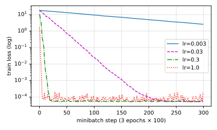

# d2l 3.2 线性回归的从零开始实现

> 教材：https://zh.d2l.ai/chapter_linear-networks/linear-regression-scratch.html
> 输出均为本机 `d2l` 环境实跑（torch 2.14.1）。
> 前置：[3.1 线性回归](d2l-3.1-线性回归.md)　下一节：[3.3 简洁实现](d2l-3.3-线性回归的简洁实现.md)

本节只用**张量 + 自动微分**，把数据流水线、模型、损失、优化器全部手写一遍。框架能自动做这些事，但手写一遍才知道框架在替你做什么。

## 目录

0. 前置速览：autograd（第 2.5 节，我们跳过了）
1. 生成人造数据集
2. 读取小批量：`data_iter`
3. 初始化参数
4. 模型、损失、优化器三个函数
5. 训练循环 —— 整本书反复出现的那段代码 ★
6. 结果：学到的参数 vs 真实参数
7. 练习 1–7
8. 小结

---

## 0. 前置速览：autograd

本节要用到自动微分，而 [2.5 自动微分](https://zh.d2l.ai/chapter_preliminaries/autograd.html) 我们跳过了，这里补够用的部分（和 [2.4 微积分](d2l-2.4-微积分.md) 最后的伏笔接上：数值微分不可用，框架用的是这个）。

```python
x = torch.arange(4.0, requires_grad=True)   # ① 声明"要对它求梯度"
y = 2 * torch.dot(x, x)                     # ② 前向计算,顺便记下计算图
y.backward()                                # ③ 反向传播,梯度存进 x.grad
x.grad                                      # tensor([ 0.,  4.,  8., 12.]) = 4x ✓
```

四条规则，够用来读懂本节：

| 规则 | 说明 |
|---|---|
| `requires_grad=True` | 只有这样标记过的张量才会被跟踪、才有 `.grad` |
| `.backward()` 只能对**标量**调用 | 所以本节代码里写的是 `l.sum().backward()` 而不是 `l.backward()` |
| **梯度会累加** | 每次 `backward()` 把新梯度**加到** `.grad` 上，不是覆盖 → 更新完必须清零（`param.grad.zero_()` 或 `optimizer.zero_grad()`） |
| 更新参数要 `with torch.no_grad():` | 否则参数更新本身会被记进计算图 |

梯度会累加这条是最容易踩的 —— 忘了清零，第二个批量的梯度会叠在第一个上面，训练就乱了。本节的 `sgd` 函数在更新完**立刻清零**，就是这个原因。

---

## 1. 生成人造数据集

用已知的 $\mathbf{w}=[2,-3.4]^\top$、$b=4.2$ 加噪声造 1000 个样本，这样**可以用学到的参数和真值对比**来判断训练对不对：

$$\mathbf{y} = \mathbf{X}\mathbf{w} + b + \epsilon, \qquad \epsilon \sim \mathcal{N}(0, 0.01^2)$$

```python
def synthetic_data(w, b, num_examples):  #@save
    """生成 y = Xw + b + 噪声"""
    X = torch.normal(0, 1, (num_examples, len(w)))
    y = torch.matmul(X, w) + b
    y += torch.normal(0, 0.01, y.shape)
    return X, y.reshape((-1, 1))

true_w = torch.tensor([2, -3.4]); true_b = 4.2
features, labels = synthetic_data(true_w, true_b, 1000)
```

实测：

```
features[0] = [-1.5256, -0.7502]     label[0] = 3.7036
features.shape = (1000, 2)           labels.shape = (1000, 1)
```

**注意 `y.reshape((-1, 1))`**：标签被做成列向量 `(1000,1)` 而不是 `(1000,)`。这是本节一连串形状问题的源头（见练习 5）。

散点图能直观看出 `features[:, 1]` 和 `labels` 的线性关系（负相关，因为 $w_2 = -3.4$）：

```python
d2l.set_figsize()
d2l.plt.scatter(features[:, 1].detach().numpy(), labels.detach().numpy(), 1)
```

---

## 2. 读取小批量：`data_iter`

```python
def data_iter(batch_size, features, labels):
    num_examples = len(features)
    indices = list(range(num_examples))
    random.shuffle(indices)                      # 打乱顺序
    for i in range(0, num_examples, batch_size):
        batch_indices = torch.tensor(
            indices[i: min(i + batch_size, num_examples)])
        yield features[batch_indices], labels[batch_indices]
```

几个点：

- `random.shuffle` 打乱**索引**而不是数据本身，然后用索引张量一次取出整批（花式索引）；
- `min(i + batch_size, num_examples)` 是为了**最后一批可能不满**（练习 7）；
- 用 `yield` 做成生成器，边训练边产出，不用一次性把所有批量都建好。

```python
for X, y in data_iter(10, features, labels):
    print(X.shape, y.shape)    # (10, 2) (10, 1)
    break
```

批量特征形状 = `(批量大小, 特征数)`，批量标签形状 = `(批量大小, 1)`。

> 书里明确说了这个实现**效率很低**：要求所有数据都在内存里，且做大量随机内存访问。框架的内置迭代器（3.3 的 `DataLoader`）能处理文件和数据流，还能多进程预取。所以这个 `data_iter` 是教学版，不要拿去用在真实项目里。

关于为什么用小批量而不是单样本：GPU 处理几百个样本的时间并不比处理一个样本多多少 —— 每个样本的前向和梯度都能并行。批量太小等于浪费算力。

---

## 3. 初始化参数

```python
w = torch.normal(0, 0.01, size=(2, 1), requires_grad=True)
b = torch.zeros(1, requires_grad=True)
```

权重从 $\mathcal{N}(0, 0.01^2)$ 采样，偏置置 0，两者都要 `requires_grad=True`（否则 `backward()` 不会给它们算梯度）。`w` 的形状是 `(2,1)` 而不是 `(2,)` —— 配合 `(n,2) @ (2,1) → (n,1)`，和标签形状一致。

---

## 4. 模型、损失、优化器三个函数

```python
def linreg(X, w, b):  #@save
    """线性回归模型"""
    return torch.matmul(X, w) + b        # (n,2)@(2,1) → (n,1),  +b 广播

def squared_loss(y_hat, y):  #@save
    """均方损失"""
    return (y_hat - y.reshape(y_hat.shape)) ** 2 / 2

def sgd(params, lr, batch_size):  #@save
    """小批量随机梯度下降"""
    with torch.no_grad():
        for param in params:
            param -= lr * param.grad / batch_size
            param.grad.zero_()
```

逐个对照 [3.1](d2l-3.1-线性回归.md)：

- `linreg` = $\hat{\mathbf{y}} = \mathbf{X}\mathbf{w}+b$，其中 `+b` 靠广播加到每个分量；
- `squared_loss` = $\frac{1}{2}(\hat{y}-y)^2$，**逐样本**返回，没有求和/求平均；那个 `reshape` 很关键（练习 5）；
- `sgd` 三件事：原地更新、**除以 `batch_size`** 把总和变成平均（这样换批量大小时步长不跟着变）、**梯度清零**。

`param -= ...` 用原地写法（[2.1 第 8 节](d2l-2.1-数据操作.md)），在 `torch.no_grad()` 里做，不进计算图。

---

## 5. 训练循环 ★

书里说"理解这段代码至关重要，因为相同的训练过程几乎一遍又一遍地出现" —— 确实，后面每一章都是这个骨架：

```python
lr = 0.03
num_epochs = 3
net = linreg
loss = squared_loss

for epoch in range(num_epochs):
    for X, y in data_iter(batch_size, features, labels):
        l = loss(net(X, w, b), y)        # ① 前向:算这批的损失,形状 (bs,1)
        l.sum().backward()               # ② 反向:求和成标量再回传
        sgd([w, b], lr, batch_size)      # ③ 更新参数(内含清零)
    with torch.no_grad():
        train_l = loss(net(features, w, b), labels)
        print(f'epoch {epoch + 1}, loss {float(train_l.mean()):f}')
```

**为什么是 `l.sum().backward()` 而不是 `l.backward()`**：`l` 的形状是 `(batch_size, 1)` 不是标量，而 `backward()` 要求标量。`sum()` 把它们加起来；对应地 `sgd` 里除以 `batch_size` 还原成平均。（也可以写 `l.mean().backward()` 并去掉 `sgd` 里的除法 —— 见 [3.3 练习 1](d2l-3.3-线性回归的简洁实现.md)。）

实测（lr=0.03, 3 轮, 批量 10）：

```
epoch 1, loss 0.026058
epoch 2, loss 0.000101
epoch 3, loss 0.000052
```

第一轮就降到 0.026，第二轮进入 1e-4 量级 —— 这里的"下限"约等于噪声方差的一半（$\sigma^2/2 = 0.01^2/2 = 5\times10^{-5}$），和实测的 0.000052 吻合。**损失降不到 0 不是没训练好，是数据本身有噪声**，这个下界是数据给的。

---

## 6. 结果：学到的参数 vs 真实参数

```python
print(f'w的估计误差: {true_w - w.reshape(true_w.shape)}')
print(f'b的估计误差: {true_b - b}')
```

```
w 的估计误差: [ 0.00084, -0.00040]
b 的估计误差: [-1.00e-05]
```

误差在 1e-3~1e-5 量级。书里补了一句很重要的话：

> 在机器学习中，我们通常不太关心恢复真正的参数，而更关心如何高度准确地预测。

因为深度网络里**有许多参数组合都能给出同样好的预测**（权重可以互换、缩放等），"找回真参数"这件事本身既做不到也没必要。

---

## 7. 练习 1–7

### 练习 1：权重初始化为零会怎样？算法还有效吗？

**对线性回归，完全有效。** 实测把 `w` 初始化成 `torch.zeros(2,1)`：

```
最终 loss: 0.000052   w = [1.9997, -3.3998]   b = 4.1998
```

和随机初始化的结果一模一样。原因：线性回归的损失是**凸函数**，只有一个最小值，从哪儿出发都会收敛到它；而且梯度 $\mathbf{x}^{(i)}(\hat{y}-y)$ 在 $\mathbf{w}=\mathbf{0}$ 处不为零，更新能正常启动。

> ⚠️ **但对深度网络就不行了**（这是本练习真正想问的）。多层网络里如果所有权重都初始化成同一个值，同一层的所有神经元会算出完全相同的输出、收到完全相同的梯度，于是永远保持相同 —— 等价于每层只有一个神经元。这叫**对称性问题**，必须靠随机初始化打破。所以书里用 `normal(0, 0.01)` 而不是零，是为了后面的章节养成习惯。

### 练习 2：电压和电流的关系，自动微分能学参数吗？

**能。** 欧姆定律 $V = IR$（或含偏置的 $V = IR + V_0$）本身就是线性模型：把电流当特征、电压当标签，$R$ 就是要学的权重。整节代码改一下数据就能直接用，autograd 照常工作。

不过真实场景有两个坑：① 导体电阻随温度变化，严格说不是常数（模型欠拟合）；② 若电流测量也有误差，就成了"自变量有噪声"的情形，最小二乘的估计会有偏 —— 这类问题要用全最小二乘 / Deming 回归。

### 练习 3：能基于普朗克定律用光谱能量密度确定物体温度吗？

**能，但这是非线性回归。** 普朗克定律

$$B_\lambda(T) = \frac{2hc^2}{\lambda^5}\cdot\frac{1}{e^{hc/(\lambda k_B T)} - 1}$$

对 $T$ 不是线性的，没有解析解，但**可以用同一套流程**：把 $T$ 设成 `requires_grad=True` 的参数，用测到的多个波长下的辐射值算平方损失，autograd 求梯度，SGD 迭代。

实际要注意：① $T$ 必须为正，常用 $T = e^{\theta}$ 这类重参数化来保证；② 不同波长的量级差很多，要归一化否则梯度尺度失衡；③ 初值不好容易卡住（非凸）。工程上也常用更省事的办法 —— 找峰值波长套维恩位移定律 $\lambda_{\max}T \approx 2.898\times10^{-3}\,\text{m·K}$ 得到初值，再用梯度下降精调。

### 练习 4：计算二阶导数会遇到什么问题？怎么解决？

**问题：一阶梯度算完，计算图默认就被释放了**，没法在它上面继续求导：

```python
x = torch.tensor(3.0, requires_grad=True)
g, = torch.autograd.grad(x**3, x)        # 27.0 ✓
torch.autograd.grad(g, x)
# RuntimeError: element 0 of tensors does not require grad and does not have a grad_fn
```

**解决：`create_graph=True`**，让反向传播本身也建图：

```python
g, = torch.autograd.grad(x**3, x, create_graph=True)
h, = torch.autograd.grad(g, x)
# h = 18.0 = 6x  ✓
```

代价和另外两个坑：

1. **显存和计算翻倍** —— 要保存反向图；二阶导数（Hessian）对 $d$ 个参数是 $d\times d$，大模型根本存不下，所以实践中用 Hessian-向量积而不是整个矩阵；
2. **梯度累加**在这里特别容易踩。实测：

   ```python
   x = torch.tensor(3.0, requires_grad=True)
   (x**3).backward(create_graph=True)   # x.grad = 27.0
   x.grad.backward()                    # x.grad = 45.0  ← 27 + 18 累加了!
   ```

   二阶结果被加到一阶结果上。要么中间 `x.grad = None` 清零，要么改用 `torch.autograd.grad`（不写入 `.grad`，更干净）—— PyTorch 自己也会警告 `backward(create_graph=True)` 可能造成引用循环导致内存泄漏。

### 练习 5：为什么 `squared_loss` 里需要 `reshape`？

因为 `y_hat` 是 `(n,1)`、`y` 可能是 `(n,)`，**两者相减会触发广播，变成 `(n,n)`**：

```python
y_hat.shape = (10, 1)    y.shape = (10,)
(y_hat - y).shape                      = (10, 10)   ← 广播成矩阵!
(y_hat - y.reshape(y_hat.shape)).shape = (10, 1)    ← 正确
```

而且**不报错**，只是结果全错。用 `y_hat = [0..9]ᵀ`、`y = [0..9]` 实测：

```
错误版 loss.sum() = 825.0        正确版 = 0.0
```

正确答案是 0（预测完全正确），错误版算出 825 —— 它算的是"每个预测和每个标签"的两两误差。这就是 [2.1 第 6 节](d2l-2.1-数据操作.md)、[2.3 练习 6](d2l-2.3-线性代数.md) 反复出现的同一个坑：**广播会悄悄把形状对上然后给出错误结果**。`reshape` 是在给它上保险。

### 练习 6：不同学习率，损失下降的快慢

实测（3 轮，批量 10，其他不变）：

| lr | 每轮 loss | 说明 |
|---|---|---|
| 0.0001 | 17.4 → 17 → 16.7 | 太小，几乎没动 |
| 0.003 | 9.33 → 4.9 → 2.57 | 在下降但远没收敛 |
| **0.03** | 0.0261 → 9.65e-05 → 5.17e-05 | 书里的选择，恰好 |
| 0.3 | 5.16e-05 → 5.4e-05 → 5.5e-05 | 一轮就到噪声下界，但之后在下界附近抖 |
| 1.0 | 6.04e-05 → 1.69e-04 → 6.44e-05 | 明显震荡，不再单调下降 |
| 3.0 | **inf → nan → nan** | 发散，彻底炸掉 |



（纵轴对数刻度。lr=1.0 那条可以看到在下界附近反复弹跳。）

规律：**太小 → 收敛慢；太大 → 震荡甚至发散（loss 变 nan）**。nan 一旦出现就不可逆了，因为 nan 参与任何运算都还是 nan。训练时第一轮 loss 就变 nan，首先怀疑学习率。

### 练习 7：样本数不能被批量大小整除时，`data_iter` 的行为？

**最后一批会短一截，不会报错也不会丢数据**。实测 1000 个样本、`batch_size=30`：

```
共 34 批, 批大小集合 {30, 10}, 最后一批 10 个
1000 = 33×30 + 10
```

靠的是 `min(i + batch_size, num_examples)` 这个截断。

> ⚠️ 但有个微妙的副作用：`sgd(params, lr, batch_size)` 里除的是**传进来的 `batch_size`（30）**，而最后一批只有 10 个样本。于是最后一批的梯度被多除了 3 倍，更新步长偏小 —— 不影响收敛，但严格说这一步的"平均"算错了。想精确可以改成除以 `X.shape[0]`，或者像框架那样用 `DataLoader(..., drop_last=True)` 直接丢掉不满的那批。

---

## 8. 小结

手写一遍下来，一个训练程序就是五个零件：

| 零件 | 本节的实现 | 3.3 换成框架的什么 |
|---|---|---|
| 数据迭代 | `data_iter`（shuffle + 切片 + yield） | `DataLoader` |
| 模型 | `linreg` = `X @ w + b` | `nn.Linear(2,1)` |
| 参数 | 手动建 `w`、`b` 并 `requires_grad` | `net.parameters()` 自动有 |
| 损失 | `squared_loss` | `nn.MSELoss()` |
| 优化器 | `sgd`（原地更新 + 清零） | `torch.optim.SGD` |

训练循环永远是：**前向算损失 → `backward()` → 更新参数 → 清零**。

**本节要记住的三件事**

1. `backward()` 只能对标量调用，所以写 `l.sum().backward()`；**梯度会累加**，更新后必须清零；
2. `squared_loss` 里的 `reshape` 不是多余的 —— `(n,1)` 减 `(n,)` 会广播成 `(n,n)`，不报错但结果全错（实测 825 vs 0）；
3. 损失降不到 0 是因为数据有噪声，这里的下界 $\sigma^2/2 = 5\times10^{-5}$ 和实测吻合；学习率太大会直接 nan。
